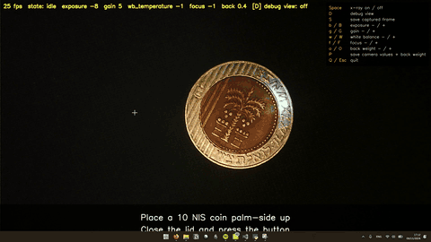

# X-Ray 10 NIS coin – prototype

A visitor places a 10 NIS coin palm-side up in the box, closes the lid and presses the
button. The camera captures a photo, finds the coin's position/rotation with SIFT, and a
scanline sweep reveals the "inside" of the coin (a photo of our modified coin) aligned to it.

[](docs/example.mp4)

*Example run (click for the 720p video).*

## Setup

```
python -m venv .venv
.venv\Scripts\activate
pip install -r requirements.txt
python main.py --source 0 --debug
```

## Assets (`assets/`)

| File | What | Notes |
|---|---|---|
| `reference.png` | A normal coin, palm side | Source of the match target. Without it, `xray.png` is matched directly. |
| `xray.png` | The modified coin, palm side | Source of the overlay. |
| `back.png` | The modified coin, reverse side | Matched as-is, only to detect a flipped coin ("flip it" message). Only its inner core is matched (`matching.back_core_only`), since the ring lettering differs by mint year, with its own lower threshold `matching.min_inliers_back`. |
| `reference_aligned.png` | Generated by `--align` | `reference.png` rotated so the coin's stripes are vertical. What the camera image is matched against. |
| `xray_aligned.png` | Generated by `--align` | `xray.png` straightened the same way and scaled to the reference size. The overlay the exhibit shows (inner core only, see `overlay.core_radius_frac`). |
| `back_aligned.png` | Generated by `--align` | `back.png` straightened, then mirrored left-right (as seen through the coin from the front), so its stripes are on the right. Blended over the whole coin in the x-ray at `overlay.back_weight` (0 = off), as if seen through it; with `tint.invert` the whole coin is inverted. |

Shoot both top-down, ideally on the exhibit rig, so lighting matches what the camera sees.
The capture tool finds the coin, crops it and saves a PNG with a transparent background:

```
python main.py --capture-template    # or: python capture_template.py
```

Select which template you are capturing with `1` front (modified coin -> `assets/xray.png`),
`2` back (-> `assets/back.png`) or `3` reference (normal coin -> `assets/reference.png`).
It starts on front; the selected one is shown on screen. Space (or R) saves to it.

After capturing any of the three, align them once:

```
python main.py --align    # -> assets/*_aligned.png, preview in debug/aligned_preview.png
```

In the capture tool, Space saves the detected coin (green circle), R lets you drag a box
around the coin manually if detection fails, Q quits. Saving again overwrites the file.

`--align` puts all three photos into one "straight" frame: the 10 NIS coin has parallel
stripes on the left of the core on both faces, and each photo is rotated until they are
exactly vertical and on the left (the back is then mirrored). This works across coin
variants, wear and the hole. It prints the detected rotation per image; if the preview
(green guide lines, ref/xray blend) looks wrong, set that image's angle in
`xray_alignment.manual_deg` in `config.yaml` and run it again.

## Keys

| Key | Action |
|---|---|
| Space | Capture button (only while the case is "closed"). In `--debug`: toggles the x-ray on/off, no case needed |
| C | Toggle the simulated case microswitch (not in `--debug`) |
| D | Toggle the diagnostic view (`--debug` only) |
| S | Save the last captured frame to `debug/` (`--debug` only), for `--diagnose` |
| b / B | Lower / raise camera exposure (`--debug` and the capture tool) |
| g / G | Lower / raise camera gain (`--debug` and the capture tool) |
| w / W | Lower / raise white balance temperature (`--debug` and the capture tool) |
| f / F | Lower / raise focus (`--debug` and the capture tool) |
| o / O | Lower / raise the back blend weight `overlay.back_weight` by `back_weight_step`, 0..1; re-renders an x-ray on screen (`--debug` only) |
| P | Save the current camera values to `config.yaml` (`--debug` and the capture tool; in `--debug` also `overlay.back_weight`) |
| Q / Esc | Quit |

## Camera settings

The camera never runs in auto mode. Exposure, gain, white balance and focus are set from
`config.yaml` (`camera` section) as soon as it opens, so colours stay the same every frame
and every restart. To find good values, run `--debug` (or the capture tool) and adjust them
live with the keys above, then press `P` to write them into `config.yaml` (comments are kept).
Capture the templates with the same values.

## Tuning

Everything lives in `config.yaml`: timings, texts, grayscale x-ray and tint (tint off by default), and matching
thresholds. Run with `--debug`, capture, press `D`, and check the inlier counts / angle /
scale. Once the rig is fixed, tighten `matching.scale_range` around the observed scale.

## Diagnosing matching

```
python main.py --diagnose                            # template keypoint statistics
python main.py --diagnose debug/capture_XXXX.png     # also a frame saved with S
```

Prints keypoint counts and inliers (outer ring vs core), and classifies every template
keypoint as *inlier*, *ambiguous* (the right spot was a candidate but the ratio test dropped
it because another spot looked the same, e.g. the stripes) or *wrong*. Writes match
visualisations to `debug/`.

The debug overlay also shows the display fps. The camera is opened as MJPG
(`camera.fourcc`) because uncompressed 1080p over USB often runs at ~5 fps.

See `OPEN_QUESTIONS.md` for deferred decisions.
